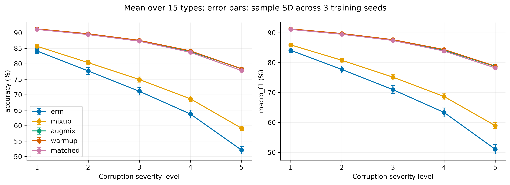

# CIFAR-10 Robustness Benchmark

基于 PyTorch 的图像分类鲁棒性实验工程。在同一个 WRN-16-2 上比较 ERM、MixUp、AugMix 及两种一致性权重设置，使用 CIFAR-10 和 CIFAR-10-C 评估干净准确率、退化表现、置信度误差与训练成本。

工程包含数据校验、确定性数据划分、训练与断点恢复、GPU 运行监控、完整评价和结果绘图。已有实验为 **5 组方法 × 3 个随机种子 × 100 轮**，共 15 次训练；每个模型评价干净测试集及 75 种退化条件。

## 结果

下表为三个训练种子的均值 ± 样本标准差。Accuracy、Macro-F1 和 ECE 的单位为百分数；时间包含单次训练、验证与监督进程开销。

| 方法 | 干净 Accuracy | 退化 Accuracy | 退化 Macro-F1 | 退化 ECE ↓ | 训练时间 / 分钟 |
|---|---:|---:|---:|---:|---:|
| ERM | 93.37 ± 0.24 | 69.76 ± 1.10 | 69.44 ± 1.26 | 17.29 ± 0.63 | 17.28 ± 0.26 |
| MixUp | 93.34 ± 0.22 | 73.76 ± 0.60 | 73.90 ± 0.72 | 10.24 ± 0.33 | 17.87 ± 0.24 |
| AugMix | 93.68 ± 0.10 | 86.12 ± 0.19 | 86.25 ± 0.22 | 3.25 ± 0.13 | 47.41 ± 2.55 |
| AugMix + weight warmup | 93.81 ± 0.04 | 86.23 ± 0.04 | 86.39 ± 0.03 | 3.15 ± 0.22 | 48.05 ± 1.92 |
| AugMix + matched constant weight | 93.75 ± 0.19 | 85.88 ± 0.25 | 86.04 ± 0.21 | 3.69 ± 0.22 | 48.79 ± 1.36 |



在当前设置下，AugMix 相对 ERM 的平均退化准确率提高 16.36 个百分点，训练时间约为 2.7 倍。权重预热相对标准 AugMix 仅提高 0.11 个百分点，三个配对种子中有一个为负，不能据此声称稳定优势或统计显著性。这里比较的是相同训练轮数下的完整训练策略，并非相同计算预算。

完整结果见 [汇总表](results/tables/summary.csv)、[逐种子结果](results/tables/metrics_by_seed.csv)、[逐条件结果](results/tables/metrics_by_condition.csv) 和 [配对差值](results/tables/paired_differences.csv)。方法和结论边界见 [实验协议](docs/EXPERIMENTS.md)。

## 环境

已验证环境：Windows 11、Python 3.12.3、PyTorch 2.5.1+cu121、torchvision 0.20.1+cu121；RTX 3050 Laptop 4 GB、约 16 GB 内存。监控程序依赖 Windows 内存接口、`taskkill` 和 NVIDIA `nvidia-smi`，当前版本未验证 Linux/macOS。GPU 训练需通过监督脚本启动。

建议使用独立环境。在已安装兼容 NVIDIA 驱动的环境中：

```powershell
python -m pip install torch==2.5.1 torchvision==0.20.1 --index-url https://download.pytorch.org/whl/cu121
python -m pip install -r requirements.txt
```

这些是本次运行使用的版本记录；未进行全新环境安装测试。已有兼容环境可以直接复用。

## 使用

以下命令在仓库根目录的 PowerShell 中运行。查看现有 CSV 和图表不需要下载数据或运行训练。

先检查小型文件校验值与 CPU 逻辑：

```powershell
New-Item -ItemType Directory -Force runs | Out-Null
python tools/prepare_reproduction.py --check-only
python scripts/check_cpu.py
python scripts/check_amp_health.py
python scripts/check_watchdog.py
```

下载、核验数据并恢复冻结协议的数据清单：

```powershell
python tools/prepare_reproduction.py
```

数据准备前要求至少 15 GiB 可用磁盘，保存训练与发布附件还需要额外空间。下载耗时取决于网络。本工具逐项比较重新生成的清单与归档清单，仅允许创建时间不同；内容全部匹配后恢复原清单字节，以通过冻结配置校验。

运行完整训练矩阵：

```powershell
$methods = @('erm', 'mixup', 'augmix', 'warmup', 'matched')
$seeds = @(17, 29, 43)
foreach ($seed in $seeds) {
    # Rotate order, matching the recorded experiment.
    $offset = [array]::IndexOf($seeds, $seed)
    foreach ($j in 0..4) {
        $method = $methods[($j + $offset) % 5]
        $run = "${method}_seed${seed}_7e8f423031"
        python scripts/supervise.py --tag "train_$run" --max-hours 8 -- scripts/train.py --config configs/frozen_v1_2.json --method $method --seed $seed
        if ($LASTEXITCODE -ne 0) { throw "Training failed: $run" }
    }
}
```

评价并重建全部图表：

```powershell
foreach ($seed in @(17, 29, 43)) {
    foreach ($method in @('erm', 'mixup', 'augmix', 'warmup', 'matched')) {
        $run = "${method}_seed${seed}_7e8f423031"
        python scripts/supervise.py --tag "evaluate_$run" --max-hours 2 -- scripts/evaluate.py --run "runs/formal/$run"
        if ($LASTEXITCODE -ne 0) { throw "Evaluation failed: $run" }
    }
}
python scripts/summarize.py --config configs/frozen_v1_2.json
```

本机正式训练、评价与绘图合计约 9.21 小时；不同硬件和环境可能不同，浮点结果不保证逐位一致。源码、数据清单和划分使用 SHA-256 校验，`.gitattributes` 禁止自动换行转换。更改已冻结的源码、方法或参数时，需要建立新的实验版本，不应把结果混入本次汇总。

原 `pipeline.py` 是带计时、审查门和重新冻结步骤的运行入口，依赖本地审查记录。首次复现请使用上述显式命令，不要把归档的审查通过记录当成本机测试结果。

## 实验附件

[Releases](https://github.com/Redmancy123/cifar10-robustness-benchmark/releases) 提供 `experiment-artifacts-v1.2.zip`：15 个验证集选择的权重、全部逐样本预测、训练历史与评价记录。SHA-256 见 [发布清单](evidence/publication_manifest.json)。压缩包不包含原始数据集及优化器恢复状态。

仅重画已有实验时，先准备数据，再在仓库根目录解压附件，最后运行 `summarize.py`。附件会恢复 `runs/` 和 `results/predictions/`。不要在已经开始的新训练目录中覆盖解压；使用单独 clone。附件中的 `completed.json` 对应归档权重，不能把它与新的训练结果混用。

## 目录

```text
configs/       冻结配置与候选配置
src/           网络、增强、损失、指标、运行监控
scripts/       数据准备、训练、评价、绘图与 CPU 检查
tools/         发布版本的数据校验辅助工具
data/splits/   固定训练与验证索引
results/       汇总 CSV 与 PNG/PDF 图表
evidence/      原始清单、训练历史、评价指标与运行摘要
docs/          实验设计与复现说明
references/    数据、方法和第三方许可说明
```

参考来源见 [来源与引用](references/来源与引用.md)，工具使用说明见 [AI_USAGE.md](AI_USAGE.md)。
